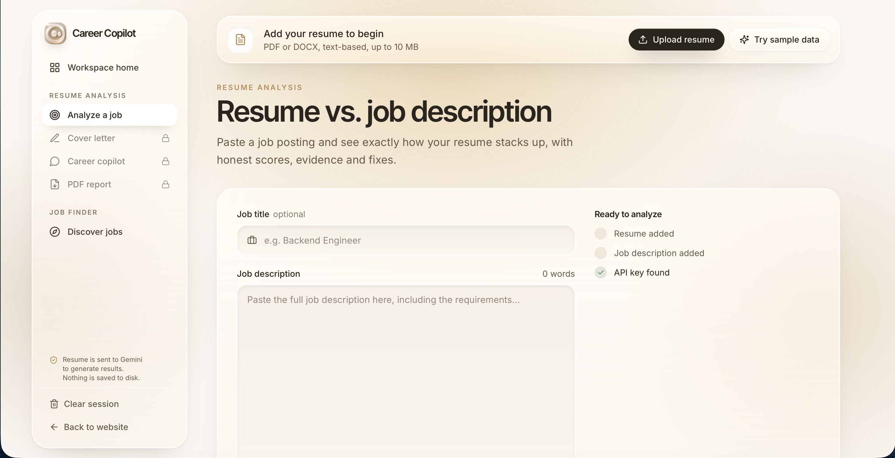
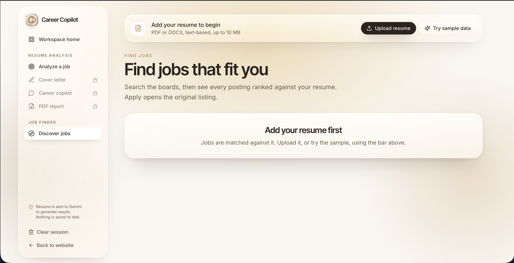

<div align="center">


# AI Career Copilot

### Turn your resume into a focused career strategy.

An AI-powered career workspace that analyzes resume-to-job fit,
identifies skill gaps, improves resume bullets without inventing
experience, drafts tailored cover letters, supports interview
preparation, and discovers relevant jobs.

**[Live Demo](https://ai-career-copilot-v2.vercel.app) · [Report a
Bug](../../issues) · [Request a Feature](../../issues)**


:::

</div>
------------------------------------------------------------------------

## Overview

AI Career Copilot helps job seekers make more informed, role-specific
career decisions. Instead of relying on a generic resume score, it
compares a resume with a target job description, surfaces evidence for
relevant skills, highlights gaps, and helps the user prepare targeted
application materials.

The application uses a **React + Vite frontend** and a **FastAPI
backend**. The backend connects to Google's generative AI service for
AI-assisted analysis and writing. The frontend and API are deployed
separately.

> **Note:** AI-generated feedback is advisory. Review all suggestions
> for accuracy before using them in a job application.

## Features

### Resume analysis

-   Upload a resume in **PDF or DOCX** format.
-   Compare the resume with a job description.
-   Generate a weighted match score across skills, experience, domain
    fit, and keywords.
-   Identify matched skills and potential gaps, with supporting
    evidence.
-   Get resume bullet-point improvement suggestions grounded in the
    experience provided.

### Application writing

-   Draft a job-specific cover letter using the resume and job
    description.
-   Check generated letter content for potentially unsupported or
    invented claims.
-   Export a shareable PDF report of the analysis.

### Career coaching

-   Explore role-specific interview questions.
-   Get suggestions for addressing skill gaps.
-   Ask career questions informed by the resume and target role.

### Job discovery

-   Suggest relevant job titles and search terms from a resume.
-   Search supported job-board sources and Adzuna when configured.
-   Filter results by location, recency, and experience range where
    supported.
-   Review a fit score and send a job into resume analysis.

### User experience

-   Modern React interface with reusable UI components.
-   Sample data to explore the workflow without uploading a personal
    resume.
-   Separate frontend and backend for independent deployment.

## Live Demo

**Frontend:** `https://ai-career-copilot-v2.vercel.app`\
**Backend health:**
`https://ai-career-copilot-v2-nt1s.onrender.com/api/health`\
**API documentation:**
`https://ai-career-copilot-v2-nt1s.onrender.com/api/docs`

Replace the example domains above with your deployed Vercel and Render
URLs.

### Screenshots

Add screenshots of the live application to a `docs/screenshots/`
directory, then update the image paths below.

  -----------------------------------------------------------------
  Resume analysis                                                   
  -----------------------------------------------------------------
    

  ---------------------------------------------------------------
  Job discovery
  ---------------------------------------------------------------
  
  
  ---------------------------------------------------------------------------------------------------------------------------------

## Architecture

``` text
┌──────────────────────────────────┐
│        User's Web Browser        │
│     React 19 + Vite frontend     │
│          Hosted on Vercel        │
└────────────────┬─────────────────┘
                 │ HTTPS / JSON
                 ▼
┌──────────────────────────────────┐
│           FastAPI API            │
│       Hosted on Render           │
│                                  │
│  Resume parsing and validation   │
│  Match analysis and skill gaps   │
│  Cover letter and career coach   │
│  Job discovery and PDF reports   │
└─────────┬──────────────┬─────────┘
          │              │
          ▼              ▼
┌─────────────────┐  ┌──────────────────┐
│ Google GenAI API│  │ Job data sources  │
│ AI-assisted work│  │ JobSpy / Adzuna*  │
└─────────────────┘  └──────────────────┘

*Optional job-source integrations depend on availability and configuration.
```

### Main API endpoints

  Method   Endpoint                   Purpose
  -------- -------------------------- ------------------------------------------
  `GET`    `/api/health`              Health and configuration status
  `POST`   `/api/parse`               Parse an uploaded resume
  `POST`   `/api/analyze`             Analyze resume against a job description
  `POST`   `/api/letter`              Generate a tailored cover letter
  `POST`   `/api/letter/check`        Check letter claims
  `POST`   `/api/coach/suggestions`   Get coaching suggestions
  `POST`   `/api/coach`               Career coaching conversation
  `POST`   `/api/roles`               Suggest relevant roles
  `POST`   `/api/jobs`                Search for jobs
  `POST`   `/api/report`              Generate a PDF report

Interactive API documentation is available at `/api/docs` when the
backend is running.

## Tech Stack

  Layer             Technologies
  ----------------- -----------------------------------------
  Frontend          React 19, Vite, Tailwind CSS v4, Motion
  Backend           Python, FastAPI, Uvicorn
  AI integration    LangChain, Google Generative AI
  Resume parsing    pdfplumber, python-docx
  PDF generation    ReportLab
  Job discovery     python-jobspy, optional Adzuna API
  Deployment        Vercel (frontend), Render (backend)
  Version control   Git, GitHub

## Getting Started

### Prerequisites

Install the following before running locally:

-   Python **3.11 or newer**
-   Node.js **18 or newer** and npm
-   A Google AI Studio API key for AI-powered features

### 1. Clone the repository

``` bash
git clone https://github.com/sunny-kr07/ai-career-copilot.git
cd ai-career-copilot
```

Replace the repository URL with your actual GitHub repository URL.

### 2. Create a Python environment

**macOS / Linux**

``` bash
python3 -m venv .venv
source .venv/bin/activate
python -m pip install --upgrade pip
python -m pip install -r requirements.txt
```

**Windows PowerShell**

``` powershell
py -m venv .venv
.venv\Scripts\Activate.ps1
python -m pip install --upgrade pip
python -m pip install -r requirements.txt
```

### 3. Configure environment variables

Create a local `.env` file from the example:

``` bash
cp .env.example .env
```

Open `.env` and add your API key. Do not commit `.env` or publish
secrets in your repository.

``` dotenv
GOOGLE_API_KEY=your_google_api_key
LLM_PROVIDER=google_genai
LLM_MODEL=gemma-4-26b-a4b-it
LLM_THINKING_LEVEL=minimal

# Optional: enable Adzuna job search if you have credentials
ADZUNA_APP_ID=
ADZUNA_APP_KEY=
ADZUNA_COUNTRY=in

# Job search configuration
JOBSPY_COUNTRY=India

# Local frontend origin
CORS_ORIGINS=http://localhost:5173,http://127.0.0.1:5173
```

Get a Google AI Studio API key from [Google AI
Studio](https://aistudio.google.com/apikey). Model availability and API
access depend on the provider and your account.

### 4. Install frontend dependencies

``` bash
cd web
npm install
cd ..
```

### 5. Start the application

You can use the project helper script:

``` bash
./dev.sh
```

Or start the API and frontend in separate terminals.

**Terminal 1 --- API** (from the repository root):

``` bash
uvicorn api.server:app --reload --port 8000
```

**Terminal 2 --- frontend:**

``` bash
cd web
npm run dev
```

Open `http://localhost:5173` in your browser. The Vite development
server proxies `/api` requests to the local API at
`http://127.0.0.1:8000`.

## Configuration Reference

  -----------------------------------------------------------------------
  Variable                Required                Description
  ----------------------- ----------------------- -----------------------
  `GOOGLE_API_KEY`        Yes for AI features     API key used by the
                                                  Google generative AI
                                                  integration

  `LLM_PROVIDER`          No                      Provider selection;
                                                  defaults to
                                                  `google_genai`

  `LLM_MODEL`             No                      Model identifier;
                                                  defaults to
                                                  `gemma-4-26b-a4b-it` in
                                                  this project
                                                  configuration

  `LLM_THINKING_LEVEL`    No                      Model
                                                  reasoning/thinking
                                                  setting where supported

  `ADZUNA_APP_ID`         No                      Adzuna application ID

  `ADZUNA_APP_KEY`        No                      Adzuna application key

  `ADZUNA_COUNTRY`        No                      Adzuna country code;
                                                  defaults to `in`

  `JOBSPY_COUNTRY`        No                      Country used for job
                                                  searches; defaults to
                                                  `India`

  `JOBSPY_PROXIES`        No                      Optional proxy
                                                  configuration for
                                                  supported job-board
                                                  requests

  `CORS_ORIGINS`          Production              Comma-separated list of
                                                  allowed frontend
                                                  origins
  -----------------------------------------------------------------------

## Deployment

The project is deployed as two services.

### Frontend --- Vercel

Configure the Vercel project with:

  ----------------------------------------------------------------------------------------------
  Setting                             Value
  ----------------------------------- ----------------------------------------------------------
  Root directory                      `web`

  Framework                           Vite

  Build command                       `npm run build`

  Output directory                    `dist`

  Environment variable                `VITE_API_BASE=https://ai-career-copilot-v2-nt1s.onrender.com`
  ----------------------------------------------------------------------------------------------

Use the base Render service URL as the value of `VITE_API_BASE`; do not
append `/api`. Redeploy the frontend after changing this variable
because Vite embeds it during the build.

### Backend --- Render

Configure the Render web service with:

  ------------------------------------------------------------------------------------------
  Setting                             Value
  ----------------------------------- ------------------------------------------------------
  Root directory                      Repository root (blank if the repository root is
                                      selected by default)

  Build command                       `pip install -r requirements.txt`

  Start command                       `uvicorn api.server:app --host 0.0.0.0 --port $PORT`
  ------------------------------------------------------------------------------------------

Add the required environment variables in Render's Environment settings.
Set `CORS_ORIGINS` to your exact Vercel origin, for example:

``` dotenv
CORS_ORIGINS=https://ai-career-copilot-v2.vercel.app
```

Do not include a trailing slash. If multiple frontend origins are
needed, separate them with commas. Save the environment changes and
redeploy the backend.

### Deployment notes

-   Free hosting tiers may sleep after inactivity and can have resource,
    build, and usage limits.
-   Job-board sources may change their access rules or availability.
-   Keep the Google API key on the backend only; never use it as a
    `VITE_` variable.
-   Verify `/api/health` after deployment and test the key workflows
    from the live frontend.

## Privacy & Security

-   Resume files may contain personal information. Only upload documents
    you are comfortable processing with this service.
-   The application is designed to process resume content in memory
    rather than save uploaded resumes to disk; review the implementation
    and hosting/provider policies before using sensitive documents.
-   AI processing sends relevant resume/job-description content to the
    configured AI provider to generate results.
-   Never commit `.env`, API keys, real resumes, or generated reports to
    GitHub.
-   Rotate any API key that is accidentally exposed.
-   Review [`SECURITY.md`](SECURITY.md) for additional security
    guidance.

## Development

Run the frontend production build:

``` bash
cd web
npm run build
```

The repository may include development dependencies and tests. If
present, consult `requirements-dev.txt` and the `tests/` directory for
the project's test commands.

## Limitations

-   AI-generated scores and recommendations are estimates, not hiring
    decisions or guarantees.
-   Job listings and fit scores depend on the available data sources and
    may be incomplete or outdated.
-   A resume-to-job match score should be used as one signal among
    several, not as a definitive measure of a candidate's suitability.
-   Free hosting and external AI APIs are subject to quotas,
    availability, and policy changes.

## Contributing

Suggestions, bug reports, and pull requests are welcome. Before
submitting changes, avoid including secrets or personal resume data in
commits.

## License

This project includes a `LICENSE` file; review it for the terms that
apply to your copy of the project.

------------------------------------------------------------------------

::: {align="center"}
**Built to help job seekers prepare with more clarity and confidence.**
:::
